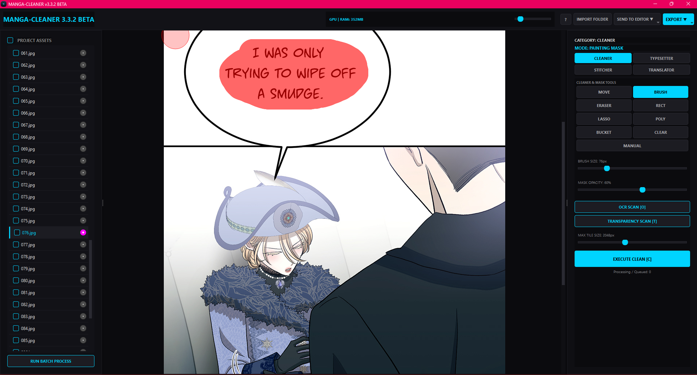

# 🌌 MANGA CLEANER STUDIO v3.3.3: The Workspaces & Typesetting Update

**High-Fidelity AI-Powered Scanlation Restoration Suite**

[](https://github.com/NeTRuNNeRGLiTCH/manga-cleaner/releases)
[](https://opensource.org/licenses/Apache-2.0)
[](https://www.python.org/)
[](https://github.com/NeTRuNNeRGLiTCH/manga-cleaner/releases)
[](https://github.com/santiagodvergara05-debug/manga-translate-studio)

Building on the modular Studio engine introduced in v3.0.0 and the toolkit expansion in v3.2.0, **Manga Cleaner Studio v3.3.3** expands Manga Cleaner into a multi-workspace scanlation tool. Four dedicated workspaces—**Cleaner**, **Typesetter**, **Stitcher**, and **Translator**—help scanlation teams move seamlessly from AI restoration to translation synchronization, text placement, and vertical page stitching without leaving the application.

---

## 🖥️ Studio Preview (v3.3.3 UI)



*Featuring the Obsidian Dark Theme, the two-column tool layout, live file-queue locking, and the four-workspace switcher (Cleaner · Typesetter · Stitcher · Translator).*

---

## 🎓 Installation & Setup Tutorial

For quick setup, follow the [Running from Source](#-running-from-source) guide below.

### 🎥 Video Walkthrough

Prefer a visual guide? Watch the video walkthrough:

[](https://www.youtube.com/watch?v=9psnwpJG3aE)

*Note: The tutorial was recorded using version 3.2.0; newer v3.3.3 Studio workspaces (Typesetter, Translator, Stitcher) operate directly inside the main UI.*

---

## 🛠️ Studio Workspaces & Capabilities

Manga Cleaner Studio unifies the complete scanlation pipeline into four specialized workspaces, allowing teams to restore, translate, typeset, and assemble webtoons and manga in a single application.

---

### 1. 🧹 Cleaner Workspace (AI Inpainting & Manual Touch-up)
* **LaMa AI Inpainting Engine:** High-resolution inpainting powered by ONNX Runtime, utilizing Snap-to-8 Dynamic ROI reflection padding to clean scans without downscaling or quality loss.
* **Automated Scanners:** Single-key OCR text detection (`O`) and transparency/alpha channel detection (`T`).
* **Complete Mask Toolkit:** Brush (`B`), Eraser (`E`), Rectangle (`R`), Freehand Lasso (`L`), Polygonal Selection (`P`), and Bucket Fill (`G`).
* **Manual Cleaner Brush (`D`):** Paint directly onto flat speech bubbles or backgrounds without triggering AI overhead.
* **Eyedropper Color Picker (`I`):** Sample page pixels on the fly with `Alt + Left-Click`, supported by quick color swatches and instant pure-white reset.
* **Smart History (Undo/Redo):** `Ctrl+Z` and `Ctrl+Shift+Z` intelligently differentiate between direct image strokes (in Manual mode) and selection mask edits.

---

## 🛠️ Studio Workspaces & Capabilities

Manga Cleaner Studio unifies the complete scanlation pipeline into four specialized workspaces, allowing teams to restore, translate, typeset, and assemble webtoons and manga in a single application.

---

### 1. 🧹 Cleaner Workspace (AI Inpainting & Manual Touch-up)
* **LaMa AI Inpainting Engine:** High-resolution inpainting powered by ONNX Runtime, utilizing Snap-to-8 Dynamic ROI reflection padding to clean scans without downscaling or quality loss.
* **Automated Scanners:** Single-key OCR text detection (`O`) and transparency/alpha channel detection (`T`).
* **Complete Mask Toolkit:** Brush (`B`), Eraser (`E`), Rectangle (`R`), Freehand Lasso (`L`), Polygonal Selection (`P`), and Bucket Fill (`G`).
* **Manual Cleaner Brush (`D`):** Paint directly onto flat speech bubbles or backgrounds without triggering AI overhead.
* **Eyedropper Color Picker (`I`):** Sample page pixels on the fly with `Alt + Left-Click`, supported by quick color swatches and instant pure-white reset.
* **Smart History (Undo/Redo):** `Ctrl+Z` and `Ctrl+Shift+Z` intelligently differentiate between direct image strokes (in Manual mode) and selection mask edits.

---

### 2. 🔤 Typesetter Workspace (Typography & Styling)
* **Interactive Transform Gizmo:** Center-locked scaling corner handles prevent coordinate drift while resizing. Horizontal handles adjust word-wrap boundary width, and the top handle controls free rotation (hold `Shift` to snap to 15° increments).
* **Vector Outside Stroke:** Renders a clean outer outline beneath the letter fill with adjustable pixel width and alpha opacity. Includes one-click fill/stroke color swapping (`⇄`).
* **Font Manager & Preset Cache:** Search system fonts by family or alias, filter to favorites with **★ Only**, and assign custom use-case aliases (e.g., `★ Shout [Wild Words]`). Preferences persist automatically in `cache/font_presets.json`.
* **Show Outlines Toggle:** Switch between inspection mode (dashed cyan bounding boxes to locate accidental text placed on dark backgrounds) and a clean final preview.
* **Dual Layer Tracking:** View and center placed text items (`[ ✓ ]`) or review unplaced script dialogues (`[ + ]`) directly within **PAGE TEXT LAYERS**.

---

### 3. 📄 Translator Workspace (Script Sync & Sibling Ecosystem)
* **Shared Folder Hierarchy (`translations/`):** Two-tier folder organization (`translations/<Series>/`) shared natively with **Manga Translate Studio**.
* **Directory Management:** Create new series subfolders (`➕`) and open active directories in the native operating system file manager (`📁`).
* **Zero-RAM Lazy Queue:** Imports `.txt` scripts without pre-rendering or RAM bloat. Dialogue lines are queued as `[ + ]` items that spawn on the canvas using active font settings upon clicking.
* **Unload Script:** Clear all queued script lines across pages from memory with one click without resetting placed text or active page sessions.
* **Unicode NFC Normalization:** Guarantees character matching for Japanese, Korean, Chinese, and Latin filenames and text.

---

### 4. 🧩 Stitcher Workspace (Lossless Webtoon Assembly)
* **Vertical Page Stitching:** Combines webtoon strips into continuous files while preserving active cleanings and typeset layers.
* **Flexible Grouping Modes:** Group pages manually (`From ➔ To`), by fixed pages-per-file, or by automatic distribution into a target total file count.
* **Height Guard & Formats:** Configure automatic vertical splitting guards to prevent oversized outputs, with export options in lossless PNG or 100% 4:4:4 JPG.

---

### 5. ⚡ Studio Automation & Pipeline Integrations
* **Multi-Task Batch Processing:** Automated load ➔ scan ➔ clean ➔ export pipeline across entire chapters with live background lock indicators.
* **External Editor Bridges:** One-click direct transfer of original and cleaned layers to Adobe Photoshop or Photopea (web).
* **Natural Numerical Sorting:** Scans numbered `1`, `2`, `10`, `100` load in chronological order instead of alphabetical sequence.
* **Project Reset (`RESET`):** Safely wipe in-memory sessions, text layers, and masks to begin a new chapter without restarting the application.
---

## 🤝 Sibling Ecosystem: Manga Translate Studio

Manga Cleaner Studio is paired with **[Manga Translate Studio](https://github.com/santiagodvergara05-debug/manga-translate-studio)**, a companion desktop application for multimodal AI translation (Ollama, Gemini, Claude, OpenAI). 

Both tools share the same design language, file conventions, and root `translations/` directory, allowing teams to translate, clean, typeset, and stitch manga chapters with zero file conversion overhead.

---

## 📸 Before & After Restoration

| Original Scan | AI Restored |
| :---: | :---: |
|  |  |
|  |  |

---

## 📦 Version Comparison: GPU vs. CPU

| Feature | ⚡ CUDA GPU Edition | ☁️ Standard CPU Edition |
| :--- | :--- | :--- |
| **Ideal For** | NVIDIA GPUs with compatible CUDA runtime | Laptops and integrated graphics |
| **Package Size** | ~900 MB (build dependent) | ~260 MB (build dependent) |
| **Cleaning Speed** | Sub-second per tile | Moderate CPU execution |
| **Hardware** | NVIDIA GPU (Compute Capability 6.0+) | Modern x64 CPU |

---

## 📝 Translator Script Format

The **TRANSLATOR** workspace processes UTF-8 `.txt` script templates:

```text
### SERIES TITLE: My Series
### CHAPTER: 12

<translation>

Image 1 [001.jpg]
- First dialogue bubble
- Second bubble//with a manual line break

Image 2 [002.jpg]
-
-

</translation>

```

* Only text enclosed within `<translation>` and `</translation>` is parsed.
* Each `-` denotes a text box. Empty `-` lines are ignored.
* Use `//` for manual line breaks within the same bubble.
* `[filename]` brackets allow matching dialogues to files regardless of sort order.

---

## ⌨️ Professional Shortcuts

| Key | Action |
| --- | --- |
| `O` | Run OCR text detection |
| `T` | Scan transparent areas |
| `C` | Execute AI inpainting clean |
| `B` / `E` / `M` | Select Brush / Eraser / Move tools |
| `R` / `L` / `P` | Select Rectangle / Lasso / Polygon tools |
| `G` | Bucket Fill tool |
| `D` / `I` | Select Manual Cleaner / Eyedropper Color Picker |
| `X` | Switch to Typesetter & activate Text mode |
| `Shift + Click` | Draw straight line between points |
| `Double-Click` | Commit polygon selection / Edit existing text box |
| `Alt + Right-Click Drag` | Dynamically resize brush |
| `Alt + Left-Click` | Sample color while Manual Cleaner is active |
| `Ctrl + Scroll` | Adjust selected text font size |
| `Ctrl + Shift + Scroll` | Rotate text in 5° steps |
| `Ctrl + Z` / `Ctrl + Shift + Z` | Smart undo / redo (Image stroke in Manual mode, Mask otherwise) |
| `Alt + Z` / `Alt + Shift + Z` | Image history undo / redo (AI clean patches) |

---

## 🚀 Running from Source

Running directly from the repository is recommended for development and Linux NVIDIA GPU configurations.

### 1. Clone the Repository

```bash
git clone [https://github.com/NeTRuNNeRGLiTCH/manga-cleaner.git](https://github.com/NeTRuNNeRGLiTCH/manga-cleaner.git)
cd manga-cleaner

```

### 2. Download AI Models

Download `models.zip` from the latest release and extract it into the root directory:

```text
manga-cleaner/
├── models/
├── src/
├── assets/
└── main.py

```

### 3. Environment Setup

```bash
# Create virtual environment
python -m venv venv

# Activate virtual environment
# Windows:
.\venv\Scripts\activate
# Linux / macOS:
source venv/bin/activate

# Install dependencies (CPU / Default):
pip install -r requirements.txt

# Or for Linux with NVIDIA GPU CUDA support:
pip install -r requirements_linux_gpu.txt

```

### 4. Launch the Application

```bash
python main.py
```

---

## 👥 Contributing

Interested in contributing code, models, or optimizations? Please review **[CONTRIBUTING.md](CONTRIBUTING.md)** for development guidelines, coding standards, and compilation instructions (PyInstaller / Docker).

---

## 📜 License

Manga Cleaner Studio is open-source software licensed under the **[Apache License 2.0](LICENSE)**.

```text
Copyright © 2024-2026 NeTRuNNeRGLiTCH & Contributors.

Licensed under the Apache License, Version 2.0 (the "License");
you may not use this file except in compliance with the License.
You may obtain a copy of the License at

    [http://www.apache.org/licenses/LICENSE-2.0](http://www.apache.org/licenses/LICENSE-2.0)

Unless required by applicable law or agreed to in writing, software
distributed under the License is distributed on an "AS IS" BASIS,
WITHOUT WARRANTIES OR CONDITIONS OF ANY KIND, either express or implied.
See the License for the specific language governing permissions and
limitations under the License.

```